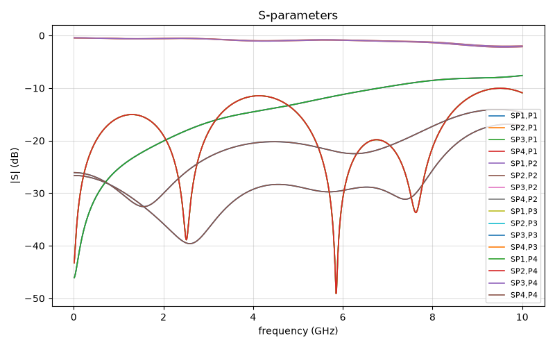
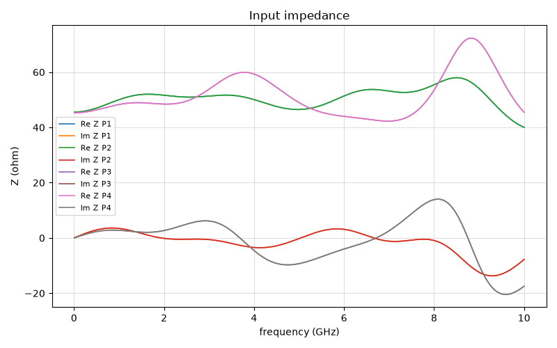
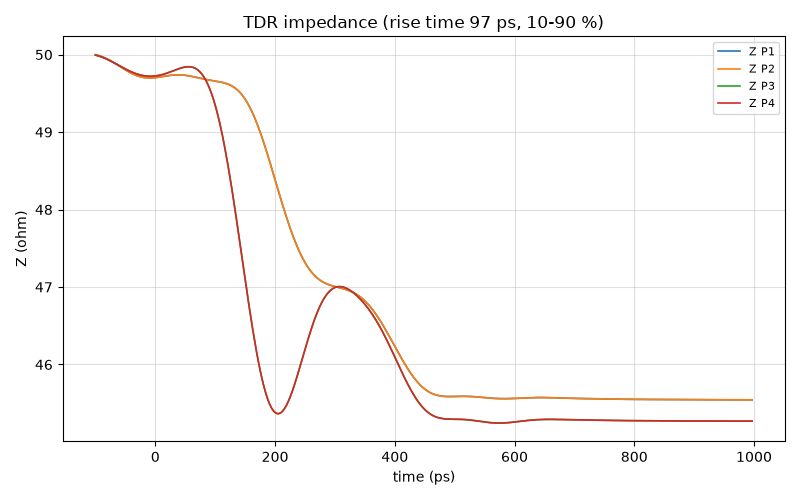

# S10d_diff_pair_0.33mm_skew_2mm

openEMS FDTD, 4 ports, each excited in turn; copper as sheets.

* Band: 0.01 to 10 GHz, 1000 points.
* Mesh: 1059456 cells, at most 0.25 mm; 4 mm of air, its outer 8 cells an absorbing boundary (PML).
* Each run takes 20000 time steps.
* Ports: lumped, 50 ohm, from the pad to the nearest copper layer with copper under it.
* TDR: a step of 97 ps rise time (10 to 90 %), over the 998 ps each run simulated.

| Port | Pad | Net | Layer |
|---|---|---|---|
| P1 | J1.1 | DP | F.Cu |
| P2 | J2.1 | DP | F.Cu |
| P3 | J3.1 | DN | F.Cu |
| P4 | J4.1 | DN | F.Cu |

## S-parameters (dB)

| | 0.01 GHz | 5.01 GHz | 10 GHz |
|---|---:|---:|---:|
| SP1,P1 | -26.62 | -28.77 | -17.09 |
| SP2,P1 | -0.42 | -0.86 | -1.98 |
| SP3,P1 | -43.23 | -14.99 | -10.90 |
| SP4,P1 | -46.08 | -12.95 | -7.62 |
| SP1,P2 | -0.42 | -0.86 | -1.98 |
| SP2,P2 | -26.62 | -28.77 | -17.09 |
| SP3,P2 | -46.08 | -12.95 | -7.62 |
| SP4,P2 | -43.23 | -14.99 | -10.90 |
| SP1,P3 | -43.23 | -14.97 | -10.88 |
| SP2,P3 | -46.08 | -12.94 | -7.59 |
| SP3,P3 | -26.08 | -20.54 | -14.61 |
| SP4,P3 | -0.45 | -0.93 | -2.13 |
| SP1,P4 | -46.08 | -12.94 | -7.59 |
| SP2,P4 | -43.23 | -14.97 | -10.88 |
| SP3,P4 | -0.45 | -0.93 | -2.13 |
| SP4,P4 | -26.08 | -20.54 | -14.61 |

## TDR impedance

| Port | min (ohm) | max (ohm) |
|---|---:|---:|
| P1 | 45.5 | 50.0 |
| P2 | 45.5 | 50.0 |
| P3 | 45.2 | 50.0 |
| P4 | 45.2 | 50.0 |

