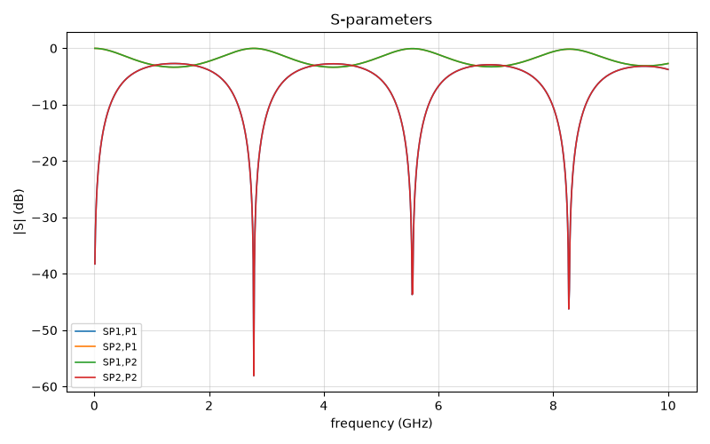
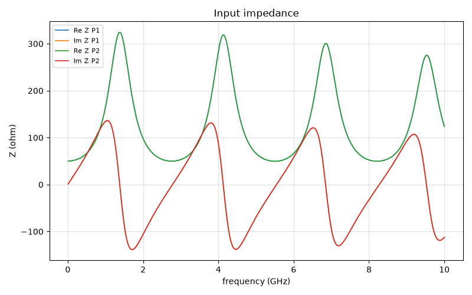
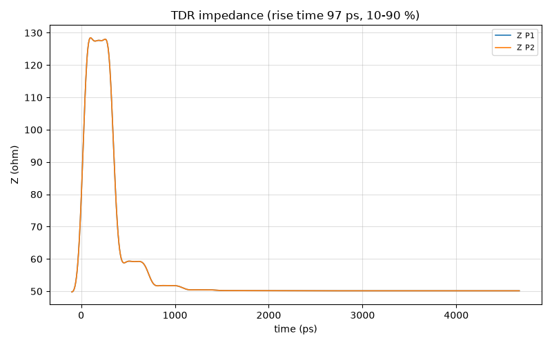

# S2_microstrip_0.3mm_lossless

openEMS FDTD, 2 ports, each excited in turn; copper as sheets.

* Band: 0.01 to 10 GHz, 1000 points.
* Mesh: 592704 cells, at most 0.25 mm; 4 mm of air, its outer 8 cells an absorbing boundary (PML).
* Each run takes 20000 time steps.
* Ports: lumped, 50 ohm, from the pad to the nearest copper layer with copper under it.
* TDR: a step of 97 ps rise time (10 to 90 %), over the 4673 ps each run simulated.

| Port | Pad | Net | Layer |
|---|---|---|---|
| P1 | J1.1 | SIG | F.Cu |
| P2 | J2.1 | SIG | F.Cu |

## S-parameters (dB)

| | 0.01 GHz | 5.01 GHz | 10 GHz |
|---|---:|---:|---:|
| SP1,P1 | -38.25 | -5.69 | -3.75 |
| SP2,P1 | -0.01 | -1.43 | -2.70 |
| SP1,P2 | -0.01 | -1.43 | -2.70 |
| SP2,P2 | -38.25 | -5.69 | -3.75 |

## TDR impedance

| Port | min (ohm) | max (ohm) |
|---|---:|---:|
| P1 | 49.8 | 128.4 |
| P2 | 49.8 | 128.4 |

