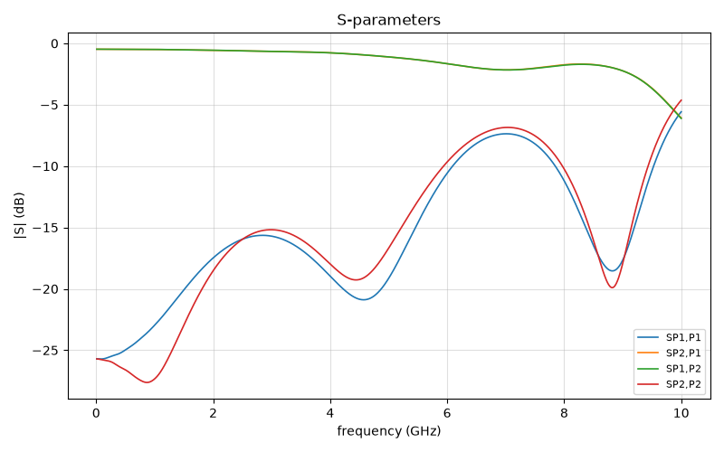
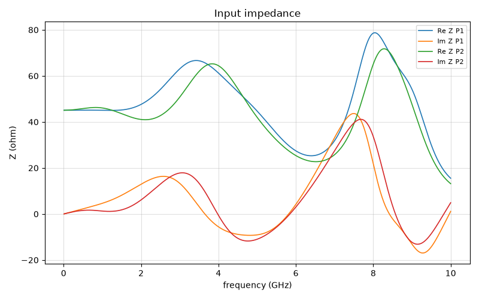
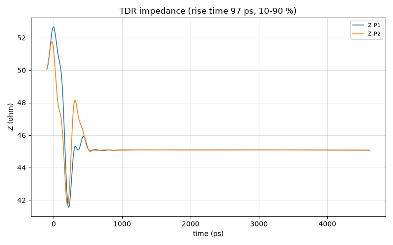

# S3a_bend_90

openEMS FDTD, 2 ports, each excited in turn; copper as sheets.

* Band: 0.01 to 10 GHz, 1000 points.
* Mesh: 731808 cells, at most 0.25 mm; 4 mm of air, its outer 8 cells an absorbing boundary (PML).
* Each run takes 20000 time steps.
* Ports: lumped, 50 ohm, from the pad to the nearest copper layer with copper under it.
* TDR: a step of 97 ps rise time (10 to 90 %), over the 4618 ps each run simulated.

| Port | Pad | Net | Layer |
|---|---|---|---|
| P1 | J1.1 | SIG | F.Cu |
| P2 | J2.1 | SIG | F.Cu |

## S-parameters (dB)

| | 0.01 GHz | 5.01 GHz | 10 GHz |
|---|---:|---:|---:|
| SP1,P1 | -25.71 | -19.07 | -5.57 |
| SP2,P1 | -0.48 | -1.11 | -6.08 |
| SP1,P2 | -0.48 | -1.11 | -6.11 |
| SP2,P2 | -25.71 | -16.61 | -4.63 |

## TDR impedance

| Port | min (ohm) | max (ohm) |
|---|---:|---:|
| P1 | 41.6 | 52.7 |
| P2 | 41.7 | 51.8 |

