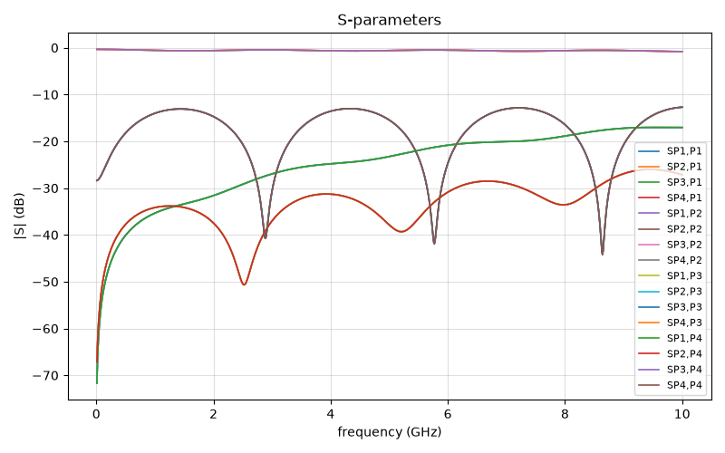
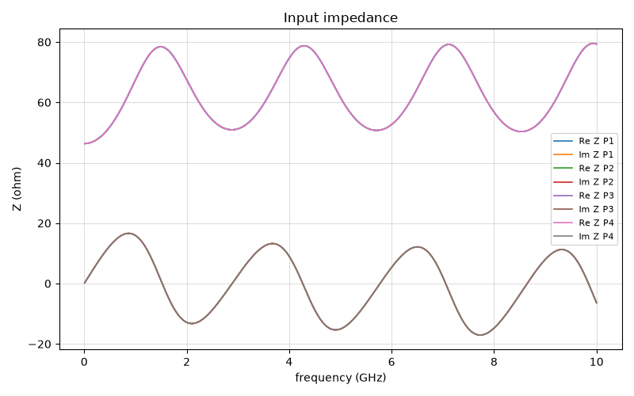
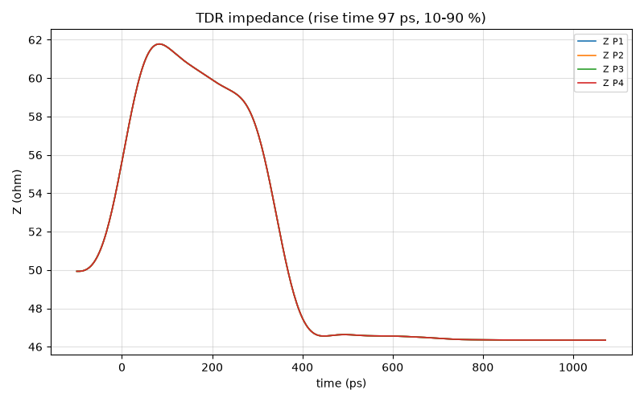

# S7_crosstalk_gap_3W

openEMS FDTD, 4 ports, each excited in turn; copper as sheets.

* Band: 0.01 to 10 GHz, 1000 points.
* Mesh: 924672 cells, at most 0.25 mm; 4 mm of air, its outer 8 cells an absorbing boundary (PML).
* Each run takes 20000 time steps.
* Ports: lumped, 50 ohm, from the pad to the nearest copper layer with copper under it.
* TDR: a step of 97 ps rise time (10 to 90 %), over the 1074 ps each run simulated.

| Port | Pad | Net | Layer |
|---|---|---|---|
| P1 | J1.1 | AGG | F.Cu |
| P2 | J2.1 | AGG | F.Cu |
| P3 | J3.1 | VIC | F.Cu |
| P4 | J4.1 | VIC | F.Cu |

## S-parameters (dB)

| | 0.01 GHz | 5.01 GHz | 10 GHz |
|---|---:|---:|---:|
| SP1,P1 | -28.37 | -15.53 | -12.70 |
| SP2,P1 | -0.34 | -0.60 | -0.81 |
| SP3,P1 | -67.12 | -37.96 | -27.14 |
| SP4,P1 | -71.71 | -23.23 | -17.04 |
| SP1,P2 | -0.34 | -0.60 | -0.81 |
| SP2,P2 | -28.37 | -15.53 | -12.70 |
| SP3,P2 | -71.71 | -23.23 | -17.04 |
| SP4,P2 | -67.11 | -37.96 | -27.14 |
| SP1,P3 | -67.11 | -37.96 | -27.14 |
| SP2,P3 | -71.70 | -23.23 | -17.04 |
| SP3,P3 | -28.37 | -15.53 | -12.70 |
| SP4,P3 | -0.34 | -0.60 | -0.81 |
| SP1,P4 | -71.70 | -23.23 | -17.04 |
| SP2,P4 | -67.11 | -37.96 | -27.14 |
| SP3,P4 | -0.34 | -0.60 | -0.81 |
| SP4,P4 | -28.37 | -15.53 | -12.70 |

## TDR impedance

| Port | min (ohm) | max (ohm) |
|---|---:|---:|
| P1 | 46.3 | 61.8 |
| P2 | 46.3 | 61.8 |
| P3 | 46.3 | 61.8 |
| P4 | 46.3 | 61.8 |

